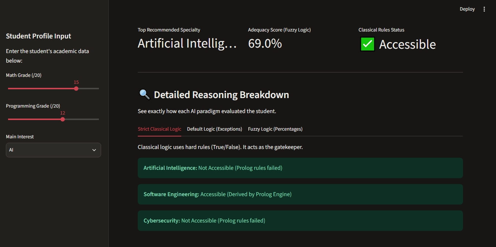
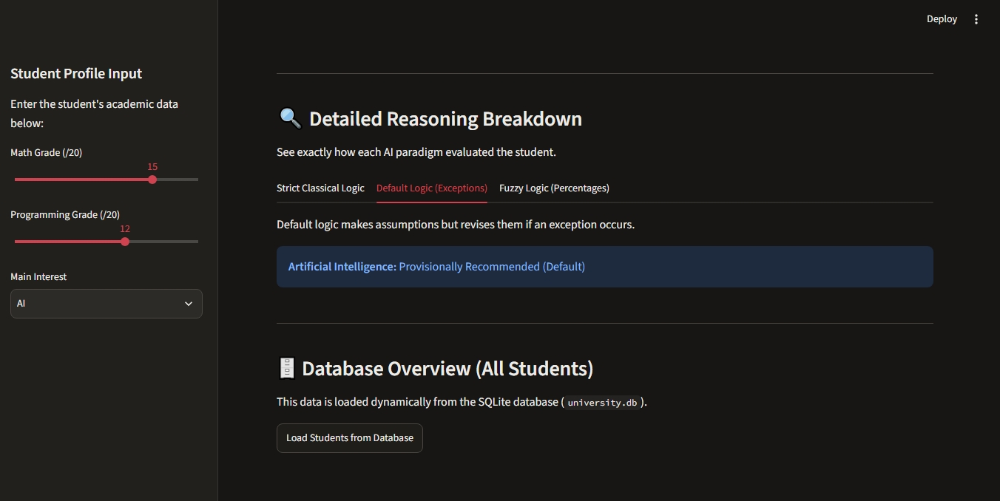
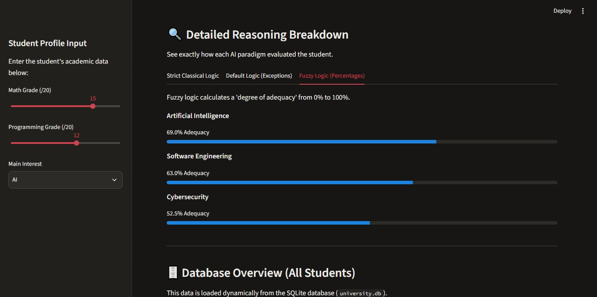

# 🎓 University Orientation Expert System





## 📌 Overview
This project is an AI-driven Expert System designed to recommend university specialties (Artificial Intelligence, Software Engineering, Cybersecurity) based on a student's academic profile and interests. 

Unlike standard software that relies on basic `if/else` statements, this system implements a **Hybrid AI Architecture** using three distinct reasoning paradigms:
1. **Classical Logic (Prolog):** Strict, rule-based gatekeeping.
2. **Default Logic (Python):** Common-sense reasoning that handles exceptions.
3. **Fuzzy Logic (Python):** Calculates a mathematical "degree of adequacy" (0-100%).

## 🛠️ Tech Stack
* **Frontend:** Streamlit (Python Web Framework)
* **Logic Engine:** SWI-Prolog (via `pyswip`)
* **Database:** SQLite3
* **Language:** Python 3.13

## 🧠 How the System Works
1. **The Knowledge Base:** Student profiles are stored in a local SQLite database (`university.db`).
2. **The Inference Engine:** When a user adjusts the sliders on the web app, the Python backend sends the facts to the Prolog engine for strict rule checking, while simultaneously running Python scripts for Default and Fuzzy logic.
3. **The Comparison Engine:** The system synthesizes the results, warning the user if a student has high potential (Fuzzy) but fails strict academic requirements (Prolog).

## 🚀 How to Run Locally

1. **Clone the repository:**
   ```bash
   git clone https://github.com/princeycodes/University_Orientation_System.git
   cd University_Orientation_System

2. **Install Dependencies:** 
*(Ensure you have Python and SWI-Prolog installed on your machine)*
```bash
pip install streamlit pyswip

3. **Initialize the Database:** 
```bash
python setup_database.py

4. **Run The Web App:**
```bash
python -m streamlit run app.py

**Author 👨‍💻:** 
*Ngang Princely Afumbom N.* 
*(GitHub: @princeycodes)*